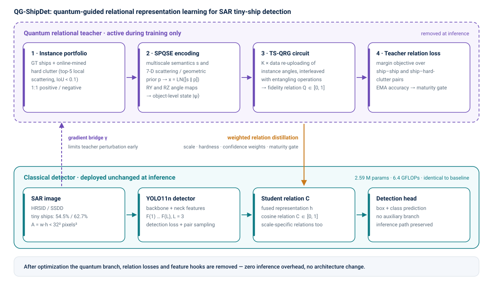
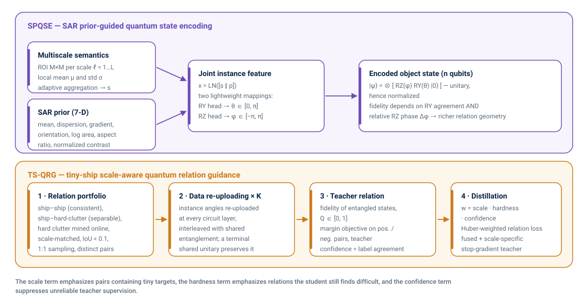
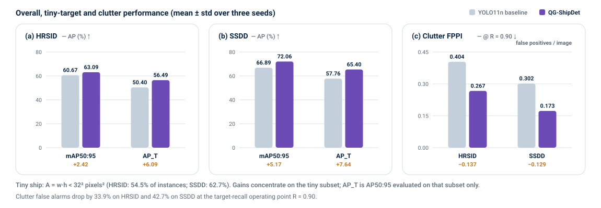
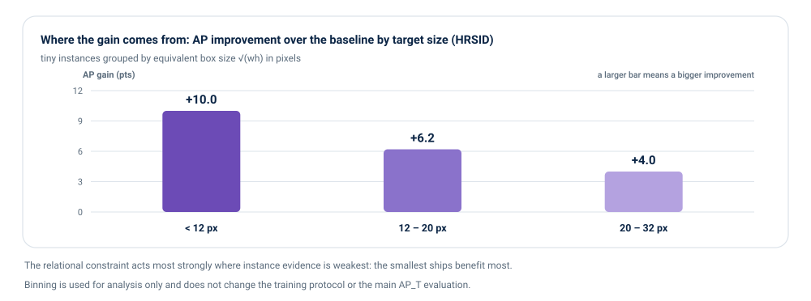

<div align="center">

<h1>QG-ShipDet</h1>

<p><b>Quantum-Guided Relational Representation Learning for Tiny Ship Detection in SAR Imagery</b></p>

<p>Chengcheng Chen<sup>1</sup>, Yunyu Chen<sup>1</sup>, Jiaying Li<sup>2</sup>, Hongyu Chen<sup>3</sup>, Yueyang Li<sup>4</sup>,<br>
Yuhao Zhou<sup>5,&#42;</sup>, Nizhuan Wang<sup>4</sup>, Zhenxue He<sup>6</sup>, Xiang Wang<sup>7</sup></p>

<p><sub><sup>1</sup>Guangzhou Maritime University · <sup>2</sup>Carnegie Mellon University · <sup>3</sup>Tongji University · <sup>4</sup>The Hong Kong Polytechnic University · <sup>5</sup>Linyi University · <sup>6</sup>Hebei Agricultural University · <sup>7</sup>Beihang University</sub>
<br><sub>&#42; Corresponding author</sub></p>

<p>
  
  
  
  
  
</p>

<p>
  <a href="#overview">Overview</a> ·
  <a href="#method">Method</a> ·
  <a href="#results">Results</a> ·
  <a href="#code-release">Code release</a> ·
  <a href="#citation">Citation</a> ·
  <a href="README.zh-CN.md">中文说明</a>
</p>

</div>

---

## Overview

SAR provides all-day, all-weather maritime surveillance, yet tiny ships remain hard to detect. The difficulty is
not only **scale**: after repeated feature downsampling a tiny ship may survive as only a handful of responses,
while speckle, coastlines, ports and man-made structures generate competing scattering patterns. In that regime
the instance-level representation itself is unreliable, and strengthening a single target's features has limited
effect.

**QG-ShipDet recasts SAR tiny-ship detection as relation-regularized representation learning.** Instead of asking
one instance to be more discriminative, it supervises the *structure between instances*: ships must stay
consistent with ships, and ships must separate from hard clutter that scatters just as strongly. The supervision
is supplied by an SAR-aware **quantum relational teacher** that encodes each candidate object into a quantum
state, builds ship–ship and ship–hard-clutter fidelity relations with **data re-uploading and intermediate
entanglement**, and distills those relations into a classical detector with **scale-, hardness- and
confidence-aware weighting**.

The teacher is a *training-time* component only. It is removed after optimization, so the deployed detector keeps
its original inference topology, parameter count and FLOPs.



## At a glance

| | HRSID | SSDD |
|---|---|---|
| Overall `mAP50:95` | 60.67 → **63.09** &nbsp;(+2.42) | 66.89 → **72.06** &nbsp;(+5.17) |
| Tiny-ship `AP_T` (A = w·h < 32² px²) | 50.40 → **56.49** &nbsp;(+6.09) | 57.76 → **65.40** &nbsp;(+7.64) |
| Tiny-ship `AR_T` | 63.23 → **70.10** | 71.07 → **79.17** |
| Clutter `FPPI@R=0.90` (lower is better) | 0.404 → **0.267** &nbsp;(−33.9%) | 0.302 → **0.173** &nbsp;(−42.7%) |
| Inference cost | 2.59 M params / 6.4 GFLOPs (unchanged) | 2.59 M params / 6.4 GFLOPs (unchanged) |

Baseline: YOLO11n. Gains are mean differences over three independent random seeds.

## Highlights

- **A new formulation for tiny targets.** Tiny-ship detection is cast as relation-regularized representation
  learning, so weak instance evidence is compensated by pairwise structural supervision rather than by a heavier
  backbone.
- **An SAR-aware quantum relational teacher.** SPQSE maps multiscale semantics, local scattering statistics and
  geometry into object-level quantum states; TS-QRG turns those states into data-dependent fidelity relations that
  the classical student cannot express on its own.
- **Where the gain lands.** The improvement is concentrated on tiny targets and on clutter suppression, not on
  overall capacity: `AP_T` rises 6.09 / 7.64 points while clutter false alarms per image drop by roughly 34% / 43%.
- **Zero inference overhead.** The quantum branch, relation losses and feature hooks are dropped after training;
  inference cost is exactly that of the baseline detector.
- **Mechanism-oriented evidence.** Direct classical relation supervision, a protocol-matched classical teacher and
  the quantum teacher are compared under the same detector and pair-sampling protocol, so relational and
  quantum-guided contributions can be told apart.

## Method

### 1. SPQSE — SAR prior-guided quantum state encoding

For every candidate instance (ground-truth ships and online-mined hard clutter in the same image) an `M×M` ROI is
sampled from each detector scale `ℓ = 1…L` and reduced to a semantic token `s` by nonparametric adaptive
aggregation over local means `μ` and standard deviations `σ`. A seven-dimensional prior `p` adds the local
scattering and geometry context: local mean response, response dispersion, gradient magnitude, normalized
orientation, log target area, log aspect ratio and the normalized central-versus-background contrast.

The joint feature `x = LN([s ‖ p])` drives **two** lightweight mappings that produce amplitude-type (`R_Y`) and
phase-type (`R_Z`) rotation angles, i.e. cooperative semantic–prior encoding rather than explicit information
disentanglement:

```text
|ψ_i⟩ = ⊗_q [ R_Z(φ_iq) R_Y(θ_iq) |0⟩ ],   θ ∈ [0, π],  φ ∈ [−π, π]
```

Because the fidelity between two encoded states depends on **both** the `R_Y` angles and the relative `R_Z`
phases, the induced relation geometry is strictly richer than single-axis angle encoding — when all phases
coincide, it degenerates to the `R_Y`-only kernel. Both rotations are unitary, so the encoded state stays
normalized by construction.

### 2. TS-QRG — tiny-ship scale-aware quantum relation guidance

Positive ship–ship relations encode class consistency; negative ship–hard-clutter relations encode discrimination
against confusable scattering. Hard clutter is mined online from high-scattering background regions
(scale-matched, IoU < 0.1 against every ship box, top-5 by local normalized scattering response), and positive and
negative pairs are sampled 1:1. Clutter–clutter relations are deliberately *not* supervised.

Querying a *shared terminal* unitary leaves all inner products unchanged, so TS-QRG interleaves
**instance-dependent data re-uploading** with **intermediate entangling operations**, making the final fidelity
`Q(u,v) = |⟨ψ_u|ψ_v⟩|² ∈ [0,1]` genuinely instance dependent. The teacher is trained with a margin objective over
ship–ship and ship–clutter pairs.

The classical student builds a fused representation from multiscale ROI features and derives its relation by
normalized cosine similarity. Distillation combines three weights:

| Weight | Intent |
|---|---|
| `w_scale` | emphasise pairs containing smaller targets |
| `w_hard` | emphasise relations the student still finds difficult (stop-gradient, so weights cannot be gamed) |
| `w_conf` | suppress teacher relations that disagree with the known pair semantics |

The fused and scale-specific student relations are distilled jointly with a Huber penalty and the same weight
normalization, so the number of valid pairs does not change the distillation strength.

### 3. Stable joint training, classical-only deployment

A controlled gradient bridge limits how much the auxiliary branch perturbs the detector backbone, while a maturity
gate driven by the EMA teacher-relation accuracy (τ₀ = 0.60, τ₁ = 0.75) and a temporal schedule switch
distillation on, ramp it up and moderately attenuate it. Detection loss, teacher loss and the weighted relation
distillation loss are optimized jointly:

```text
L_total = L_det + λ_T · L_T + s(t) · r_T · λ_QRG · L_QRG
```

At inference the auxiliary branch, relation losses and feature hooks are removed — **the deployed model is a plain
classical detector**, and its parameter count and FLOPs are identical to the baseline.



## Results

### Datasets and protocol

Experiments use **HRSID** (5,604 images / 16,951 ships) and **SSDD** (1,160 images / 2,456 ships). Following the
COCO area-partitioning principle, a **tiny ship** is an annotated box with area `A = w·h < 32² pixels²`
(54.5% of HRSID instances, 62.7% of SSDD instances). Overall quality is measured by `mAP50` and `mAP50:95`;
tiny-ship quality by `AP_T` and `AR_T` on that subset; clutter robustness by `FPPI_clutter` at the operating point
`R = 0.90`. Main comparisons and key ablations use three independent random seeds and are reported as mean ± std,
on Ubuntu 20.04, Python 3.8, PyTorch, CUDA 11.8 and a single RTX 3090.

### Main comparison

| Dataset | Method | mAP50 ↑ | mAP50:95 ↑ | AP_T ↑ | AR_T ↑ | FPPI_clutter ↓ | Params | GFLOPs |
|---|---|---|---|---|---|---|---|---|
| HRSID | YOLO11n (2024) | 88.30 | 60.67 | 50.40 | 63.23 | 0.404 | 2.59 | 6.4 |
| HRSID | NRENet (2024) | 88.72 | 61.27 | 52.30 | 64.96 | 0.356 | – | – |
| HRSID | AC-YOLO (2025) | 88.97 | 61.58 | 52.77 | 65.27 | 0.366 | 1.82 | 5.4 |
| HRSID | ASFF-Det (2025) | 89.34 | 62.03 | 53.83 | 66.49 | 0.328 | 17.6 | 66.4 |
| HRSID | LG-RSD (2026) | 89.60 | 62.40 | 54.18 | 67.11 | 0.311 | 3.01 | – |
| HRSID | **QG-ShipDet (ours)** | **90.04** | **63.09** | **56.49** | **70.10** | **0.267** | 2.59 | 6.4 |
| SSDD | YOLO11n (2024) | 96.06 | 66.89 | 57.76 | 71.07 | 0.302 | 2.59 | 6.4 |
| SSDD | NRENet (2024) | 96.41 | 67.58 | 59.58 | 72.93 | 0.269 | – | – |
| SSDD | AC-YOLO (2025) | 96.73 | 68.07 | 60.24 | 73.54 | 0.249 | 1.82 | 5.4 |
| SSDD | ASFF-Det (2025) | 97.02 | 69.34 | 61.83 | 75.01 | 0.233 | 17.6 | 66.4 |
| SSDD | DRFE-ALFF (2026) | 97.28 | 69.88 | 62.45 | 75.42 | 0.221 | 3.01 | – |
| SSDD | **QG-ShipDet (ours)** | **98.07** | **72.06** | **65.40** | **79.17** | **0.173** | 2.59 | 6.4 |

The largest margins over the strongest competing methods remain on `AP_T`, and the clutter false-positive rate is
the lowest of all compared detectors.



### Ablation — quantum state encoding (SPQSE, HRSID)

| Encoding | Multiscale semantics | SAR prior | R_Y | R_Z | mAP50:95 ↑ | AP_T ↑ | FPPI_clutter ↓ |
|---|---|---|---|---|---|---|---|
| Classical projection | ✓ | × | × | × | 61.22 | 51.73 | 0.371 |
| Generic `R_Y` | ✓ | × | ✓ | × | 61.63 | 52.65 | 0.346 |
| Generic `R_Y` + `R_Z` | ✓ | × | ✓ | ✓ | 61.94 | 53.31 | 0.329 |
| SPQSE w/o phase | ✓ | ✓ | ✓ | × | 62.38 | 54.38 | 0.303 |
| **SPQSE (full)** | ✓ | ✓ | ✓ | ✓ | **63.09** | **56.49** | **0.267** |

SAR priors and the phase degree of freedom contribute **separately**: full SPQSE improves `mAP50:95` by 0.71 and
`AP_T` by 2.11 points over the same encoding without phase, while cutting clutter FPPI from 0.303 to 0.267.

### Ablation — relation guidance (TS-QRG, HRSID)

| Variant | Quantum relation | Hard-relation mining | Reliability control | mAP50:95 ↑ | AP_T ↑ | FPPI_clutter ↓ |
|---|---|---|---|---|---|---|
| Baseline (no relation guidance) | × | × | × | 60.67 | 50.40 | 0.404 |
| + quantum teacher | ✓ | × | × | 61.41 | 52.18 | 0.353 |
| + hard-relation modeling | ✓ | ✓ | × | 62.58 | 55.61 | 0.283 |
| Classical teacher (matched control) | × | ✓ | ✓ | 62.67 | 55.48 | 0.287 |
| **TS-QRG (full)** | ✓ | ✓ | ✓ | **63.09** | **56.49** | **0.267** |

### Mechanism controls

Two controlled studies separate *how* the gain is produced. Circuit control isolates data re-uploading and
entanglement through the quantum relation gap `ΔQ`; the teacher comparison isolates the contribution of the
quantum teacher from generic relational learning, using an MLP teacher with identical inputs and distillation
protocol.

| Study | Setting | ΔQ / ΔC | mAP50:95 ↑ | AP_T ↑ | FPPI_clutter ↓ |
|---|---|---|---|---|---|
| Circuit | No re-uploading | 0.40 | 62.08 | 53.70 | 0.326 |
| Circuit | Re-uploading, no entanglement | 0.47 | 62.63 | 55.08 | 0.296 |
| Circuit | **Re-uploading + entanglement** | **0.59** | **63.09** | **56.49** | **0.267** |
| Teacher | Baseline (no relation) | 0.16 | 60.67 | 50.40 | 0.404 |
| Teacher | Direct classical relation supervision | 0.27 | 61.92 | 53.05 | 0.346 |
| Teacher | Protocol-matched classical teacher | 0.39 | 62.67 | 55.48 | 0.287 |
| Teacher | **TS-QRG (full)** | **0.45** | **63.09** | **56.49** | **0.267** |

Most of the gain comes from relational learning itself (direct relation supervision already adds 2.65 `AP_T`
points); replacing the matched classical teacher with the quantum-guided teacher adds a further 1.01 `AP_T` points
and 0.020 FPPI. We report that increment as **task-specific evidence for the quantum-guided relation geometry,
not as a claim of general quantum advantage**.

In relation space, the same progression is visible directly: `ΔQ` grows from 0.26 (`R_Y`-only encoding) to 0.39
(full SPQSE) and 0.59 (TS-QRG), while the student's `ΔC` rises from 0.16 to 0.45 after distillation — the relation
gap is formed by the teacher and then transferred to the classical detector.

### Where the gain comes from

Tiny-ship instances are grouped by equivalent box size `√(wh)`. The improvement over the baseline reaches
**10.0 `AP` points** for targets below 12 px, **6.2 points** for 12–20 px and **4.0 points** for 20–32 px: the
relational constraint acts most strongly exactly where instance evidence is weakest.



Scene-conditioned results follow the same pattern. On HRSID, `AP_T` improves by **+6.83 points inshore** and
**+5.88 points offshore**, with clutter FPPI reductions of 0.225 and 0.117 — the effect is stronger when ships
coexist with coastal and man-made scattering, yet it clearly persists in open water. Qualitatively, feature
responses concentrate on ships while non-target activations around coastlines and other high-scattering regions
are suppressed.

## Code release

> **Status: manuscript under review at IEEE Transactions on Multimedia.** As stated in the paper, the complete
> implementation will be made publicly available in this repository upon acceptance.

Everything needed to reproduce the reported numbers is planned for release:

- training and evaluation code for HRSID and SSDD,
- the QG-ShipDet modules: SPQSE encoding, the data re-uploading / entanglement circuit, fidelity relation
  construction, scale / hardness / confidence weighting, maturity gate and gradient bridge,
- configuration files matching the three-seed experimental protocol,
- evaluation tools for `mAP50:95`, tiny-ship `AP_T` / `AR_T` and clutter `FPPI@R=0.90`,
- pretrained detector weights.

Planned repository layout:

```text
QG_ShipDet/
├── configs/        # dataset, model and training configuration
├── datasets/       # HRSID / SSDD preparation + tiny-ship subset builder
├── models/
│   ├── detector/   # classical YOLO11n-based detector
│   ├── spqse/      # SAR prior-guided quantum state encoding
│   └── tsqrg/      # re-uploading circuit, fidelity relations, weighting
├── losses/         # detection, teacher relation and distillation objectives
├── tools/          # train / eval / benchmark, metric implementations
└── assets/         # figures used in this README
```

Please **watch / star** this repository to be notified when the code and weights are uploaded.

## Citation

If you find this work useful, please cite our paper:

```bibtex
@article{qgshipdet2026,
  title   = {Quantum-Guided Relational Representation Learning for Tiny Ship Detection in SAR Imagery},
  author  = {Chen, Chengcheng and Chen, Yunyu and Li, Jiaying and Chen, Hongyu and Li, Yueyang
             and Zhou, Yuhao and Wang, Nizhuan and He, Zhenxue and Wang, Xiang},
  journal = {IEEE Transactions on Multimedia},
  year    = {2026},
  note    = {Manuscript under review}
}
```

## Contact

- Chengcheng Chen — chenchengcheng@gzmtu.edu.cn
- Yuhao Zhou (corresponding author) — zhouyuhao@tongji.edu.cn

This work was supported by the National Natural Science Foundation of China (No. 52602592).

<sub>Figures in this README are original schematics and re-plotted results; no figure from the submitted manuscript
is reproduced. Code license to be announced together with the code release.</sub>
